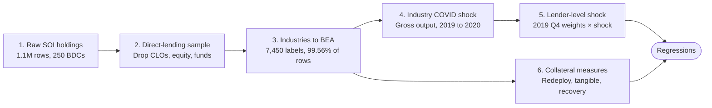

# Private Credit & Collateral: BDC Lending After the COVID Shock

I built the full data pipeline for a faculty research project on private credit: from 1.1 million raw loan records to a lender-level COVID shock and industry collateral measures, ready for regression.

**Research question.** When the COVID shock hit, did Business Development Companies (BDCs) that were more exposed shift their lending toward industries whose assets are more redeployable, more tangible, or recover more value in liquidation?

## Pipeline at a glance

## Step 1. Explore the raw dataset

The source is a parsed panel of BDC Schedule of Investments (SOI) tables from 10-K and 10-Q filings: one row per security held by a lender at a reporting date.

- **Scale.** At 2.7 GB and 274 columns, the file was too large for pandas alone, so I queried it in place with DuckDB SQL.
- **Profiling.** I mapped every column (identifiers, amounts, instrument flags, parser quality flags) and checked coverage of the three value fields among debt rows: fair value 908,425, par 903,302, amortized cost 898,342 of 914,390.
- **Instrument mix.** 914,390 rows are debt and 193,285 are equity. Within debt: 484,275 first lien, 50,100 second lien, 283,376 term loans, 86,197 unitranche, 85,208 revolvers.
- **Key finding.** "Debt" is not the same as direct corporate lending. The debt flag also catches 13,114 CLO tranches, 5,513 structured finance, 5,104 fund interests, 1,842 ABS and 272 derivatives, which had to be removed before any portfolio analysis.
- **Industry labels.** Borrower industry was free text: thousands of distinct labels mixing GICS names, provider categories and parser fragments. This became the main bottleneck (Step 3).

## Step 2. Build the direct-lending sample

I restricted the sample to loans made directly to operating companies, the activity the research question is about.

- **Keep:** debt instruments of any seniority or structure: first and second lien, term loans, revolvers, unitranche, mezzanine, secured and unsecured.
- **Drop:** equity, CLOs, structured finance, fund and investment-vehicle interests, ABS, derivatives, cash equivalents, unfunded commitments and exact parser duplicates.
- **One filing per lender-date:** where a BDC reported the same date in several filings, I kept the earliest, so amended filings are not double counted.

**Valuation basis.** Portfolio weights are computed two ways, and amortized cost is not used.

| Weighting | Why use it | Known weakness |
| --- | --- | --- |
| Fair value | Reflects current economic value of the loan | Model-based marks on illiquid loans can be smoothed ("volatility laundering") |
| Par amount | Contractual principal, no valuation discretion | Overstates value of distressed loans; ignores expected recovery |

Running both lets the professor check that results are not driven by how managers mark their books.

## Step 3. Standardize 7,450 industry labels to BEA

I mapped 99.56% of industry-tagged rows (1,117,841 of 1,122,825) to the official BEA industry hierarchy, so every loan can be linked to government industry data.

**Why BEA.** The BEA classification links directly to industry gross output (used for the shock in Step 4) and to NAICS (used for the collateral measures in Step 6). I loaded BEA's NAICS concordance with all five levels: Sector (23), Summary (73), Underlying Summary (141), Detail (406) and Gross Output Detail (418).

**Three-pass method**, always assigning the most detailed BEA level the label supports:

1. **Exact match.** Normalize text and match against all five levels: 123 labels, 5.3% of rows.
2. **Manual classification, high frequency.** Hand-classify every unmatched label with 50+ occurrences: 1,550 of 1,561 labels, covering 994,844 rows.
3. **Manual classification, long tail.** Classify the remaining labels under 50 occurrences, recording a decision type and one-line rationale for each label left unmapped (for example "parser artifact" for CLO, ticker or location text).

| Pass | Unique labels | Rows |
| --- | --- | --- |
| Exact match | 123 | 59,494 |
| Manual, 50+ occurrences | 1,550 | 994,844 |
| Manual, under 50 | 5,616 | 63,503 |
| Left unmapped (documented) | 161 | 4,984 |

**Output.** A master crosswalk `industry_bea_mapping.csv`, joined back onto the full dataset as five new columns (`bea_level1` to `bea_level5`).

## Step 4. Measure the COVID shock by industry

Each industry's shock is its change in BEA gross output from 2019 (base year) to 2020 (impact year), in dollars and in percent.

$$\Delta BEA_i = GO_{i,2020} - GO_{i,2019} \qquad \Delta BEA^{\\%}_i = \frac{GO_{i,2020} - GO_{i,2019}}{GO_{i,2019}}$$

- **Why gross output.** It measures an industry's total sales, including intermediate inputs, so it captures the revenue hit a borrower's lender would feel. I wrote a one-page methodology note on how BEA builds the series and why it suits a COVID shock.
- **Two granularities.** The professor asked for the shock under both the BEA sub-summary table (188 lines) and the detail table (414 lines), to test whether finer industries change the result.
- **Iteration.** A first version used quarterly real output (2020 Q1 to 2021 Q1). It showed the expected pattern: in Q4 2019 to Q2 2020, air transportation fell 72.8%, accommodation 62.9% and food services 39.3%. After review, the professor moved the main spec to annual 2019 to 2020 data, and I rebuilt it.
- **Caveats documented.** Chained-dollar values are not additive, so sub-industries are never summed; mining and petroleum lines mix COVID with the 2020 oil-price crash.

## Step 5. Turn industry shocks into a lender-level shock

Each BDC's exposure is the share-weighted average of the industry shocks in its loan book, using portfolio weights frozen before COVID.

$$Shock_l = \sum_i PortfolioShare_{i,l,2019Q4} \times \Delta BEA_i$$

Example: a lender with 50% in retail (output down 10%) and 50% in travel (down 90%) has a shock of 0.5 × 10% + 0.5 × 90% = 50%.

1. **Freeze pre-shock weights.** Take each lender's latest Q4 2019 filing, so exposure reflects choices made before lenders could react.
2. **Match loans to BEA rows.** Walk each loan's mapping from the most detailed level up, stopping at the first level present in the gross output table, under both the sub-summary and detail specs.
3. **Rescale.** Drop loans with no BEA match and rescale the rest to 100% per lender; the target is 95% to 97% of holdings matched.
4. **Compute shocks** in dollars and percent, under par and fair-value weights, for both specs.
5. **Validate.** Built-in checks confirm shares sum to 100%, no matched industry lacks a shock, and coverage per lender; one lender is recomputed by hand, and the two specs are compared by rank correlation.

I consolidated about 30 notebook cells across two notebooks into one 13-cell notebook that runs from raw data to `lender_covid_shock_2019_2020.csv` (one row per lender) and `portfolio_shares_2019Q4.csv` (lender × industry).

## Step 6. Attach collateral measures to each industry

I matched three published collateral measures to the same BEA industry rows, so each lender's portfolio can be scored on collateral quality every quarter.

| Measure | Source | What it captures | Mapping to BEA |
| --- | --- | --- | --- |
| Redeployability | Kim & Kung (2017), 2019 values | How easily an industry's assets can be used by other industries | NAICS-based codes matched to the longest NAICS prefix |
| Tangibility | BEA Fixed Assets | Structures and equipment versus intellectual property | Native BEA industries |
| Liquidation recovery | Kermani & Ma | PP&E liquidation value relative to book value | NAICS crosswalk |

- **Choosing a tangibility source.** Braun (2003) and Choi (2020) cover manufacturing only, while most BDC borrowers are in software, services and healthcare. The project uses BEA Fixed Assets instead because it covers every industry.
- **Aggregation rules.** Several source industries in one BEA row are averaged. Broad rows such as "Manufacturing" take the 2019-output-weighted average of their sub-industries, only if at least half the output has a value.

The resulting portfolio collateral score, the outcome variable for the regressions, is:

$$C_{l,t} = \sum_i s_{i,l,t} \times M_i$$

## Status and hand-off

The shock is built and validated; the collateral crosswalks are being finalized at both BEA granularities before the data goes to the professor for regressions.

| Deliverable | Contents | Status |
| --- | --- | --- |
| `industry_bea_mapping.csv` | 7,450 raw labels to five BEA levels | Done |
| `lender_covid_shock_2019_2020.csv` | One row per lender: shock under 2 specs × 2 weightings | Done |
| `portfolio_shares_2019Q4.csv` | Pre-shock lender × industry weights | Done |
| Collateral measures by BEA industry | Three measures on sub-summary and detail rows | In progress |
| Quarterly lender × industry panel, 2018 to 2021 | Same pipeline as the 2019 Q4 base, every quarter | In progress |

**Next (professor):** test whether lenders with larger shocks shifted toward high-collateral industries, using long-difference, panel difference-in-differences and lender × industry specifications.

### Skills demonstrated

- **Large-data engineering:** SQL on a 1.1M-row, 274-column file with DuckDB; reproducible Jupyter pipelines.
- **Data cleaning at scale:** instrument filtering, de-duplication, and classification of 7,450 messy text labels with documented decisions.
- **Economic data:** BEA gross output, fixed assets and NAICS concordances; real versus nominal and chained-dollar caveats.
- **Research judgment:** fair-value versus par weighting, pre-determined exposure, coverage thresholds, robustness specs.
- **Communication:** methodology notes and step-by-step notebooks a professor can audit and rerun.
